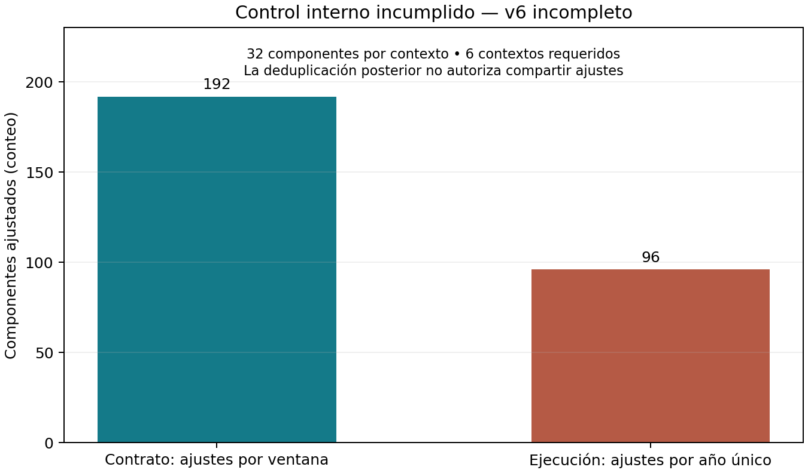

# Objetivo 3. Evaluación predictiva territorial y cierre del experimento exploratorio v6

## Objetivo, datos y alcance

El objetivo fue evaluar si un procedimiento predefinido podía mejorar la predicción del puntaje global promedio territorial respecto a persistencia. Se mantuvo la población de estudiantes de grado once, sin privación de libertad reportada, con seis puntajes presentes y positivos y sin filtro por calendario. La ubicación fue la del colegio y se conservó la media global recibida, sin sustituirla por un promedio de subpruebas. La evaluación acordada asignó igual peso a 165 pares de 33 territorios entre 2021 y 2025; estas cantidades describen el diseño, no una cobertura v6 validada.

El panel local conserva niveles desde 2018, excluye 2020 y define cada cambio respecto al máximo año previo disponible del mismo territorio, sin anualizar. Para el primer año externo, el previo fue 2019. Este último año sirvió como historial, pero no como respuesta supervisada, porque no existe el cambio previo requerido. Los años externos ya habían sido examinados durante el desarrollo; cualquier resultado admisible de este proceso sería exploratorio, sin confirmación independiente ni pronóstico anticipado demostrado.

## Antecedentes verificados

Los resultados anteriores se recalcularon actualmente desde predicciones guardadas, sobre llaves y observados cotejados. La persistencia v3 obtuvo MAE 3.429267 puntos frente a 4.879557 puntos del procedimiento v2, con mejora de 29.721754 %. El ganador fue persistencia; esta comparación no demuestra aprendizaje del IPM. Las referencias globales v5 y recencia coincidieron exactamente con persistencia en llaves, observados y predicciones, por lo que no representan evidencia independiente.

Tabla 1. Recálculos actuales de resultados históricos. Los porcentajes usan las bases indicadas y no se suman entre sí. Los resultados de memoria son exploratorios y no son conclusiones v6.

| Antecedente | MAE (puntos) | RMSE (puntos) | Mejora (%) | Base de mejora |
|---|---:|---:|---:|---|
| v2_global | 4.879557 | 6.194961 | 0.000000 | referencia idéntica o base propia |
| v3_persistencia | 3.429267 | 4.314921 | 29.721754 | v2 global |
| v5_global | 3.429267 | 4.314921 | 0.000000 | referencia idéntica o base propia |
| recencia_global | 3.429267 | 4.314921 | 0.000000 | referencia idéntica o base propia |
| memoria_global | 3.367610 | 4.306244 | 1.797975 | v3 persistencia |
| memoria_memoria | 3.004299 | 4.212666 | 12.392390 | v3 persistencia |

## Contrato del último experimento

La grilla cerrada v6 contenía 39 candidatos: persistencia, nivel histórico por media o mediana, memoria del cambio, regularización, historia completa o últimos años, Ridge, árboles pequeños, componente común y componente común con corrección territorial. Se conservaron el objetivo, la población, las variables y las ventanas. Año, código, intervalos, conteos, IPM y tasas de privación no entraron como predictores. Los niveles constantes debían contabilizarse como estimaciones históricas, aun sin llamar a sklearn.fit.

Cada componente ajustado debía utilizar un Pipeline nuevo por candidato y ventana, con StandardScaler estimado solo en entrenamiento. La selección se fijó exclusivamente mediante ventanas internas: banda MAE de 0.1 puntos, luego banda RMSE de 0.1 puntos dentro del grupo, menor número de entradas predictoras y orden establecido. Las constantes contaron como cero entradas y persistencia tuvo prioridad en el orden. La ventana externa inicial quedó fijada en persistencia, sin ajuste, puntuación ni selección. El primario fue global_v6 y la meta pactada fue una mejora adicional de 5 % frente a persistencia. No se autorizó reemplazarlo por la mejor política externa.

## Incidencia de implementación y decisión de cierre

Durante el piloto se identificó que el runner construía un ajuste interno por candidato y año de validación y lo reutilizaba entre ventanas externas. Esto incumplió el requisito de ajustes nuevos por componente, candidato y ventana. La deduplicación de copias estaba permitida únicamente después de ejecutar los ajustes y comprobar identidad de contexto y salida; no permitía compartir el ajuste para producir esas copias.

El contrato requería 192 componentes ajustados internos, mientras el registro durable contiene 96 componentes internos. Esta diferencia es un error de implementación propio, no una razón para modificar los criterios de evaluación. Los tests de la fase de implementación habían pasado, pero no verificaron adecuadamente que el runner preservara la identidad de las ventanas durante la ejecución. La aceptación inicial se conserva como antecedente documental y queda invalidada por este control indispensable.

El piloto se interrumpió. Antes del último trabajo pendiente, el registro consolidó 175 componentes terminados y 58 estimaciones constantes. Estos son conteos operativos durables, no una afirmación sobre la totalidad de ajustes que pudo iniciar el último proceso. El último snapshot consolidado registraba 309.232 segundos; al no contar con medición consolidada del pendiente, se consumieron conservadoramente los 7200 segundos del presupuesto conforme a la regla de caída. El ledger se cerró sin reapertura ni reinicio.

La ejecución principal terminó por interrupción, pero no quedó consolidado el registro individual de terminación del último trabajador. Este control se mantiene incompleto y no se sustituye por una afirmación de aprobación. La auditoría independiente cotejó 258 contextos disponibles frente a fuentes, matrices, fechas, defaults, unidades, escalas, coeficientes o estructura de árbol y predicciones guardadas. Estos cotejos locales no corrigen el incumplimiento de ejecución por ventana ni la cobertura incompleta.

La figura presenta un control técnico de conteos y no una comparación de desempeño. El impacto del hallazgo es impedir una evaluación válida del procedimiento v6. La alternativa verificable fue conservar los artefactos, registrar la incidencia, auditar únicamente lo disponible y cerrar incompleto. Se adoptó esta alternativa sin repetir ajustes, ampliar el presupuesto, crear otro experimento o reinterpretar el mejor resultado parcial.

## Resultado admisible y limitaciones

**V6 no produjo un resultado primario técnicamente válido. No se calculó ni se declara una mejora v6, éxito o fracaso de la meta, ni una conclusión sobre nivel frente a rezago, regularización, historia o corrección a partir de este piloto.** Las predicciones parciales se conservan como evidencia de ejecución, pero no se sintetizan como resultados de la tesis. El cierre distingue el fallo de implementación de los antecedentes históricos que sí pudieron recalcularse.

La conservación por huellas no autentica la fuente local ni acredita la disponibilidad temporal de los datos. El antecedente de Guainía conserva 238 registros completos frente a 404 con puntaje global disponible y una diferencia de 21.012106 puntos, en diagnóstico_medias_disponibles.csv de v2, filas de archivo 57 y 90. Se mantuvo la media recibida; no se corrigió la población para mejorar el error. El IPM describe hogares y Saber 11 describe estudiantes; la ubicación del colegio no equivale a residencia. La agregación territorial, dependencia entre años y territorios y escasez de años limitan las interpretaciones ecológicas. No se atribuyen efectos causales ni se reportan p-valores confirmatorios.

## Conclusión y siguiente horizonte condicional

Los antecedentes verificables muestran el valor de una referencia simple de persistencia y la necesidad de separar resultados exploratorios de evidencia independiente. La ejecución final v6 se cierra incompleta por un control indispensable, sin rescatar una política externa ni atribuir eficacia al procedimiento incompleto. La auditoría de lo disponible y el notebook documentan qué pudo verificarse y qué permanece pendiente; no constituyen aceptación técnica completa del experimento.

El último año utilizable comprobado en el panel local fue 2025. El siguiente año sería 2026 solo condicionalmente a datos comparables y disponibilidad verificable, con autorización separada. El registro local de consulta en auditoria/fuentes_verificadas.md no acredita una fecha histórica de publicación o disponibilidad del panel. No se emitieron proyecciones, no se ejecutó el objetivo siguiente y no se seleccionó ni entrenó un modelo final.

## Ubicaciones verificables

Notebook ejecutado: fase3/02_resultados_objetivo3.ipynb, desde notebook_resultados.py y generar_notebook.py. Auditoría: fase3/AUDITORIA_INCOMPLETA.json; fase3/tablas/trabajos_consolidados_verificados.csv. Incidencia y cierre: fase2/DETENCION_CONTROLADA.json, fase2/ACEPTACION.json y fase2/piloto/ledger.json; estado abierto anterior preservado en fase2/antecedentes/ledger_interrumpido.json. Contrato: PROTOCOLO_V6.md §§2–7 y ESPECIFICACION_V6.json/budget/windows. Antecedentes recalculados y Guainía: fase3/tablas/antecedentes_recalculados.csv y guainia_historico.csv; fuentes originales en sus columnas source/file. Disponibilidad: fase3/DISPONIBILIDAD.json y registro local auditoria/fuentes_verificadas.md líneas3–7. EVIDENCIAS_TEXTO.csv liga cada cifra a celda, función, archivo, tabla, llave, tamaño, unidad y huella. No se añadieron citas bibliográficas ni resultados inexistentes.
