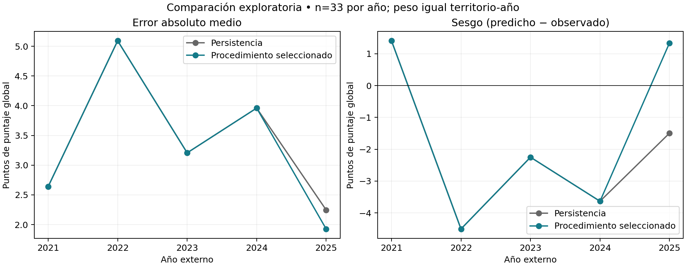
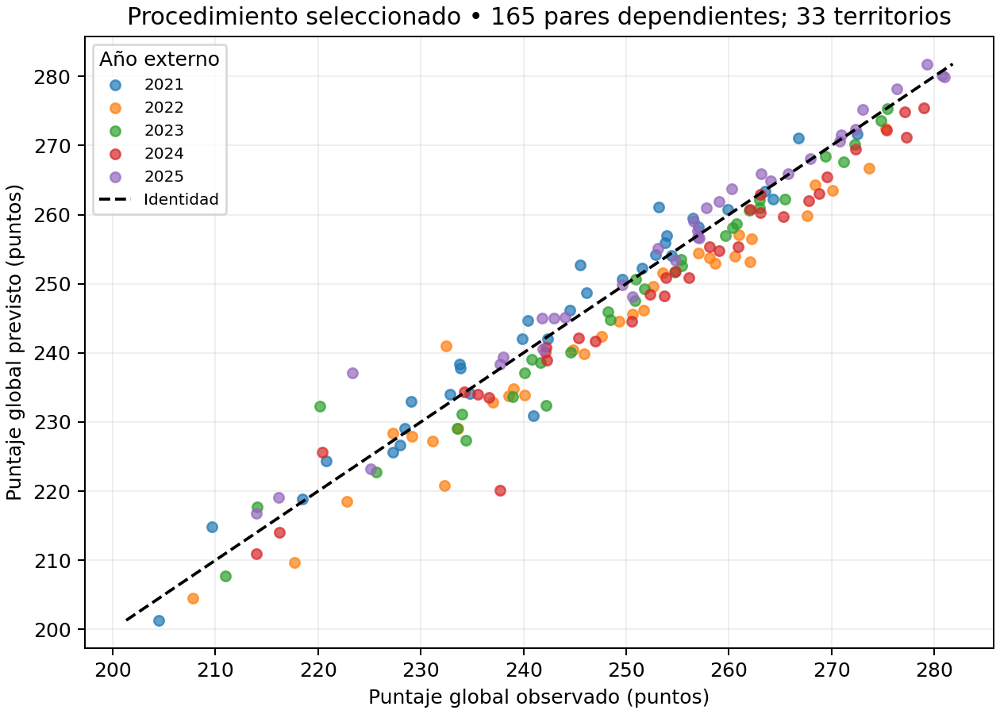
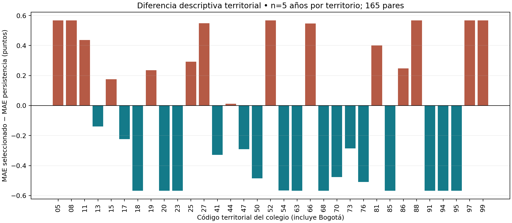

# Objetivo 3. Diseño y evaluación exploratoria de la predicción departamental

### Unidad de análisis y alcance de la evaluación

Se evaluó la capacidad de distintos procedimientos para estimar el puntaje global promedio de Saber 11 a nivel departamental. La unidad de observación fue el par territorio-año, considerando los departamentos y Bogotá D. C. según la ubicación del establecimiento educativo. Se conservaron los registros de estudiantes de grado once, sin privación de libertad reportada y con puntajes presentes y positivos en las pruebas y en el global, sin restringir el calendario. La variable de resultado fue la media del puntaje global recibido. Cada territorio-año recibió el mismo peso; por tanto, las métricas no representan un promedio nacional ponderado por el número de estudiantes.

El objetivo planteado en la investigación considera la predicción a partir del IPM y sus indicadores. Para examinar su desempeño, se recalcularon las métricas de las predicciones departamentales ya obtenidas con indicadores de pobreza y se contrastaron con una referencia temporal. Como evaluación complementaria, se examinó si el nivel histórico y el rezago de los cambios del puntaje ofrecían una mejora adicional. Este contraste complementario incorpora exclusivamente información histórica del resultado; su eventual mejora no constituye evidencia de aprendizaje del IPM.

El panel local reunió 231 observaciones de nivel para 33 territorios. Se conservaron niveles desde 2018 y se excluyó 2020. La evaluación reunió 165 pares entre 2021 y 2025. La inclusión de la última anualidad amplió de manera exploratoria el periodo originalmente formulado en la investigación. Los datos se analizaron como agregados locales conservados; su coherencia y sus huellas no demuestran por sí solas autenticidad oficial ni disponibilidad en la fecha en que se habría emitido una predicción.

### Diseño temporal y procedimientos examinados

La persistencia se definió como la predicción del puntaje del año anterior disponible para el mismo territorio. El cambio observado correspondió a la diferencia entre el puntaje actual y ese antecedente. En 2021, el año previo fue 2019; ese cambio no se anualizó. El cambio de 2019 se conservó como historial, sin utilizarlo como respuesta supervisada, dado que no se dispone de un cambio anterior que permita construir su rezago.

Las respuestas de entrenamiento precedieron estrictamente al año evaluado. Las variantes de historia reciente tomaron las últimas respuestas anuales elegibles después de comprobar sus rezagos, conservando los niveles necesarios para construirlas. Cuando no hubo respuestas elegibles, se utilizó persistencia; con una respuesta anual completa se permitió estimar el procedimiento. El primer año de evaluación mantuvo persistencia fija, sin ajuste ni selección. Para las anualidades posteriores se emplearon validaciones internas acumuladas de años anteriores, y la decisión se guardó antes de generar la predicción externa.

Se examinaron 39 candidatos previamente definidos: persistencia; media y mediana de cambios históricos; regresiones de mediana con rezago y distintas penalizaciones; Ridge; árboles de profundidad limitada; estimaciones del cambio común; y combinaciones de cambio común con corrección territorial. El cambio común fue la mediana de los cambios territoriales de cada año, mientras que la corrección fue la diferencia entre el cambio territorial y ese componente. El componente común empleó una observación por año; los componentes territoriales conservaron las observaciones de cada territorio. Estas unidades de entrenamiento no equivalen a estudiantes independientes.

Cada estimación utilizó exclusivamente los años autorizados para su ventana. La estandarización se calculó con el entrenamiento correspondiente, y los componentes se ajustaron de forma independiente. El puntaje previsto se reconstruyó sumando el cambio estimado al puntaje previo, sin recortarlo ni calibrarlo con el año evaluado. Las medias y medianas históricas se trataron como estimaciones, aunque no necesitaran un algoritmo de ajuste iterativo.

La selección se basó en el MAE interno: se conservaron los candidatos situados hasta 0,1 puntos por encima del mínimo. Dentro de ese grupo se aplicó la misma banda al RMSE, y se prefirieron menos entradas predictoras y el orden previamente establecido. Las estadísticas constantes contaron como procedimientos sin entradas predictoras y la persistencia tuvo prioridad en el desempate. La evaluación principal correspondió al procedimiento completo de selección, sin sustituirlo por un candidato elegido por sus resultados externos.

### Resultado principal

El procedimiento con indicadores de pobreza presentó un MAE de 4,879557 puntos. Sobre las mismas observaciones, la persistencia obtuvo 3,429267 puntos, una reducción descriptiva del 29,721754 % respecto al primero. Estas cifras corresponden a recálculos de predicciones ya guardadas. La comparación no demuestra que el IPM carezca de utilidad en general; muestra que el procedimiento examinado no superó esta referencia temporal bajo las condiciones evaluadas.

En el contraste complementario, el procedimiento seleccionado alcanzó un MAE de **3,365358 puntos** y un RMSE de **4,304688 puntos**, frente al MAE de persistencia de **3,429267 puntos**. La reducción relativa del MAE fue **1,863645 %**. En consecuencia, **no se alcanzó la meta previamente establecida de 5 % de mejora adicional**. El sesgo promedio fue de -1,529156 puntos; su signo negativo indica subestimación media del puntaje.

Tabla A. Selecciones realizadas con validaciones de años anteriores. La primera anualidad mantuvo persistencia fija.

| Año evaluado | Procedimiento elegido con años anteriores |
| --- | --- |
| 2022 | Persistencia |
| 2023 | Persistencia |
| 2024 | Persistencia |
| 2025 | Mediana del cambio territorial; historia completa |

La selección conservó persistencia hasta la penúltima anualidad y eligió la mediana histórica del cambio territorial en 2025. Para ese año, el cambio constante estimado fue de 2,834273 puntos, a partir de 132 cambios territoriales históricos. La mejora agregada del procedimiento provino de esa última anualidad; no debe interpretarse como un avance uniforme durante todo el periodo.

En la comparación pareada, el procedimiento redujo el error absoluto en 18 observaciones, lo aumentó en 15 y empató en 132. La dirección prevista del cambio coincidió con la observada en 27 pares. La persistencia prevé cambio nulo, por lo que este indicador exige igualdad de signo, incluido el cero; no equivale a acertar la magnitud del cambio ni reemplaza al MAE.

### Errores por año y territorio

La tabla B presenta el error absoluto, el error cuadrático, el sesgo y la coincidencia de dirección. Las métricas se expresan en puntos del puntaje global; un sesgo positivo indica sobreestimación. Las variaciones anuales muestran que la mejora agregada convive con diferencias de magnitud y signo que deben conservarse en la interpretación.

| Procedimiento | Año | n | MAE | RMSE | Sesgo | Dirección coincidente |
| --- | --- | --- | --- | --- | --- | --- |
| Procedimiento seleccionado | 2021 | 33 | 2,6402 | 3,5097 | 1,4071 | 0 |
| Procedimiento seleccionado | 2022 | 33 | 5,0920 | 5,5535 | -4,5062 | 0 |
| Procedimiento seleccionado | 2023 | 33 | 3,2073 | 4,0108 | -2,2509 | 0 |
| Procedimiento seleccionado | 2024 | 33 | 3,9603 | 4,9211 | -3,6351 | 0 |
| Procedimiento seleccionado | 2025 | 33 | 1,9270 | 3,0312 | 1,3393 | 27 |
| Persistencia | 2021 | 33 | 2,6402 | 3,5097 | 1,4071 | 0 |
| Persistencia | 2022 | 33 | 5,0920 | 5,5535 | -4,5062 | 0 |
| Persistencia | 2023 | 33 | 3,2073 | 4,0108 | -2,2509 | 0 |
| Persistencia | 2024 | 33 | 3,9603 | 4,9211 | -3,6351 | 0 |
| Persistencia | 2025 | 33 | 2,2466 | 3,1031 | -1,4949 | 0 |

Figura A. Error absoluto medio y sesgo por año. Ambas series coinciden cuando se seleccionó persistencia; cada anualidad conserva el mismo peso territorial.

Figura B. Puntajes observados y previstos del procedimiento seleccionado. La línea de identidad permite examinar la magnitud y dirección de las desviaciones, sin atribuirles una interpretación causal.

Figura C. Diferencia del MAE territorial respecto a persistencia. Los valores negativos indican reducción del error; los positivos muestran deterioro. Las comparaciones abarcan el periodo completo y no excluyen territorios desfavorables.

### Nivel histórico, rezago y complejidad del procedimiento

La tabla C reúne contrastes descriptivos sobre las mismas observaciones. Los candidatos individuales se presentan como diagnósticos del diseño y no sustituyen el resultado del procedimiento seleccionado, aunque alguno tenga menor error externo. La diferencia corresponde al MAE del segundo procedimiento menos el del primero. Las comparaciones por pérdida y por árbol modifican más de un aspecto del estimador, por lo que no permiten atribuir sus diferencias exclusivamente a la pérdida o a la no linealidad. Las tablas completas conservan todos los candidatos y contrastes examinados.

| Comparación A → B | MAE A | MAE B | Diferencia B − A | B mejora | B empeora | Empates |
| --- | --- | --- | --- | --- | --- | --- |
| Mediana histórica → regresión sin penalización | 2,9833 | 3,7639 | 0,7806 | 45 | 87 | 33 |
| Regresión de mediana: α=0 → α=1 | 3,7639 | 3,0043 | -0,7596 | 83 | 49 | 33 |
| Historia completa → últimas dos respuestas; α=1 | 3,0043 | 2,9633 | -0,0410 | 31 | 35 | 99 |
| Regresión de mediana → Ridge; α=1 | 3,0043 | 3,3845 | 0,3802 | 49 | 83 | 33 |
| Regresión sin penalización → árbol de profundidad uno | 3,7639 | 3,2597 | -0,5043 | 91 | 41 | 33 |
| Común → común y corrección; α=0 | 4,6264 | 4,6578 | 0,0314 | 63 | 69 | 33 |
| Común → común y corrección; α=1 | 3,4365 | 3,4365 | 0,0000 | 0 | 0 | 165 |

La incorporación del rezago sin penalización presentó un error superior al de la mediana histórica. La penalización más elevada examinada redujo el error de esa regresión; sin embargo, su coeficiente de rezago fue nulo en 10 de 10 ajustes auditados con historia completa. En esas estimaciones, el procedimiento operó como un nivel constante del cambio. Por ello, la mejora no demuestra que se hubiera aprendido una dependencia temporal activa. Para distinguir un nivel histórico aprendido de un aporte activo del rezago, se examinaron los coeficientes y se compararon las predicciones con las estimaciones históricas sobre las mismas respuestas elegibles.

La regresión de mediana puede admitir un intervalo de soluciones cuando el conjunto de respuestas tiene tamaño par. En 4 ajustes auditados, el intercepto difirió del promedio de los dos valores centrales, aunque permaneció en el intervalo de medianas. Esta diferencia ayuda a interpretar por qué una regresión con coeficiente nulo no necesariamente reproduce exactamente la mediana estadística utilizada como referencia. No se reemplazó ninguna de las dos convenciones para favorecer sus métricas.

La reducción de la historia produjo cambios descriptivos pequeños en el contraste presentado, con mejoras y deterioros en distintos pares. Los árboles limitados redujeron el error frente a la regresión sin penalización del contraste, sin que ello los convierta en el resultado principal. La corrección territorial tampoco aportó una ventaja uniforme: sin penalización aumentó ligeramente el MAE del componente común, mientras que con la penalización elevada ambos procedimientos coincidieron. Estos resultados se refieren a los parámetros, muestras y ventanas examinados; no establecen superioridad universal de una familia ni autorizan una selección retrospectiva por el mejor error externo.

### Limitaciones e interpretación del objetivo

Todos los años de evaluación habían sido observados durante el desarrollo del análisis. Las separaciones temporales evitan incorporar el año evaluado al ajuste y a la selección de su ventana, pero no constituyen una confirmación independiente del diseño. Los pares comparten territorios y años, y las copias de validaciones internas no son nuevas observaciones. Ante el reducido número de anualidades, los resultados se presentan como descriptivos y exploratorios, sin pruebas confirmatorias de significación ni intervalos de incertidumbre no estimados.

La población utilizada también delimita la interpretación. El diagnóstico histórico de Guainía registró 238 observaciones con puntajes completos frente a 404 con global disponible, con una diferencia de 21,012106 puntos entre sus medias. Se conservó la población y la media previamente definidas; esta diferencia se reporta como antecedente de sensibilidad de la agregación, sin modificar el análisis para mejorar sus resultados. El IPM caracteriza hogares, mientras que Saber 11 corresponde a estudiantes evaluados; además, el departamento del colegio no equivale necesariamente al de residencia. Estas diferencias impiden trasladar directamente los resultados agregados a relaciones individuales.

La revisión técnica verificó conservación, fechas de entrenamiento, matrices, selección y correspondencia de las predicciones guardadas. Esta aceptación no autentica la fuente local, no establece su disponibilidad histórica y no demuestra pronóstico anticipado. Asimismo, el contraste dinámico complementa la evaluación con indicadores de pobreza, pero no valida íntegramente las especificaciones, pruebas de robustez y reservas originalmente propuestas, ni permite atribuir cambios del puntaje a modificaciones del IPM.

Los resultados permiten documentar el diseño y desempeño de los procedimientos examinados y reconocer la persistencia como una referencia exigente. La mejora adicional del procedimiento seleccionado fue limitada y no cumplió el umbral establecido. El alcance del objetivo queda delimitado por esta evaluación exploratoria: no se demuestra utilidad incremental del IPM ni capacidad de anticipación independiente. El último año utilizable comprobado en el panel local fue 2025; la siguiente anualidad sería 2026, de manera condicional a información comparable y disponibilidad verificable. No se estimaron puntajes de esa anualidad ni escenarios de modificación de la pobreza.
