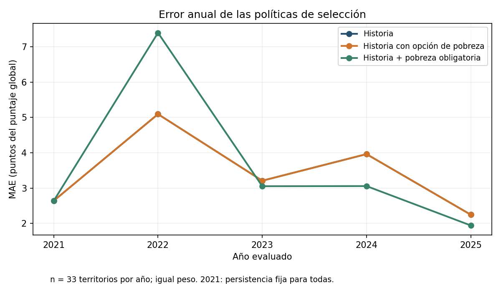
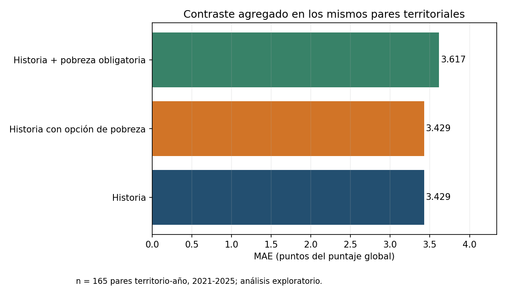
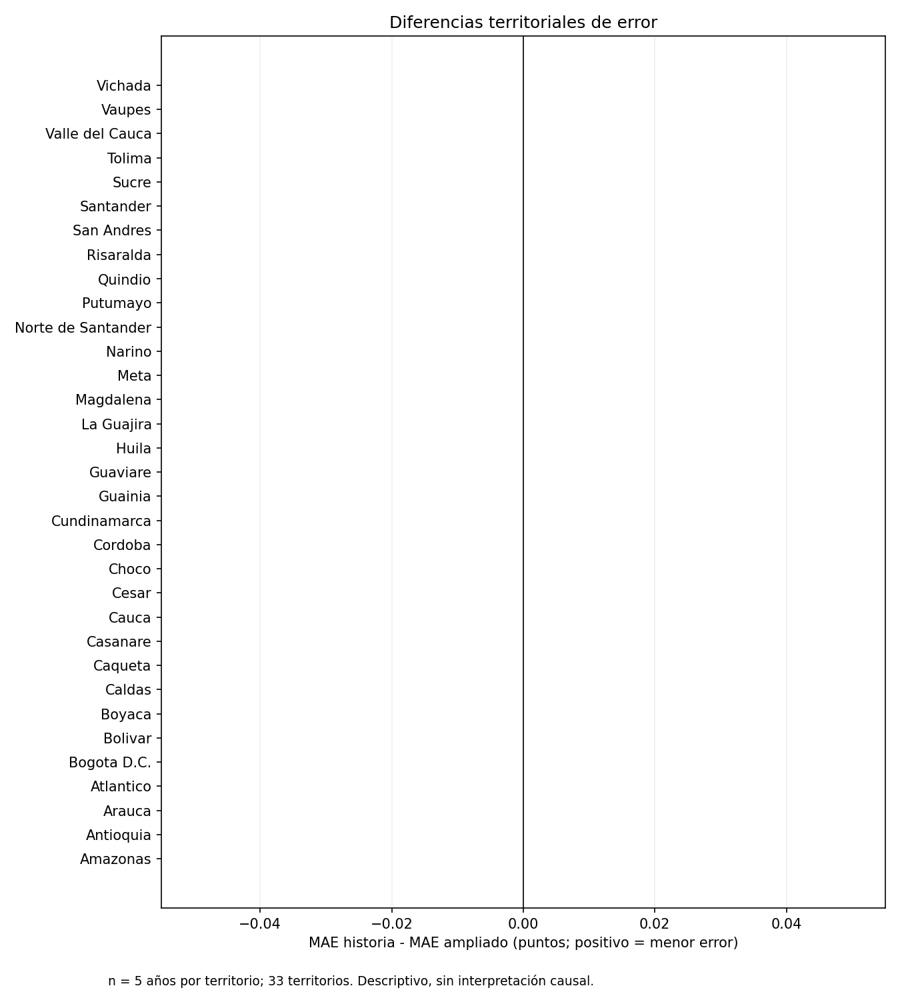

# Aporte de la pobreza multidimensional frente a la historia del desempeño académico

Como complemento al diseño predictivo departamental, se examinó si la incidencia de la pobreza multidimensional o sus tasas de privación aportan información adicional a la historia del puntaje global de Saber 11. El propósito es comparar estimaciones condicionales territoriales, sin atribuir cambios del desempeño a intervenciones sobre la pobreza. La unidad de análisis es el par territorio-año y se conserva el promedio del puntaje global recibido, vinculado al departamento del establecimiento educativo. Cada par tiene igual peso; los conteos de evaluados no se emplean como predictores.

La base local contiene 231 observaciones, correspondientes a 33 territorios y 7 años: 2018, 2019 y 2021-2025. La evaluación comprende 165 pares de 2021-2025. Los puntajes de 2018 y 2019 se utilizan exclusivamente para construir historia; 2020 queda excluido. Para 2021, el puntaje anterior es el de 2019 y el cambio histórico se calcula frente a 2018, sin anualizar el intervalo.

La historia (H) incluye el puntaje del año disponible anterior y el cambio registrado entre los dos años disponibles anteriores. La incidencia (I) se expresa como porcentaje de personas; los quince indicadores (D), como porcentajes de hogares. Se comparan H, I, D, H+I (HI) y H+D (HD), sin reunir simultáneamente el índice y las tasas. La pobreza del año evaluado funciona como condición contemporánea de estimación. Su disponibilidad anticipada no ha sido demostrada, por lo que el ejercicio no acredita una predicción prospectiva factible.

Se emplean la persistencia del puntaje previo, regresión ridge con penalizaciones 0,1, 1 y 10 y árboles de profundidad máxima dos, con al menos once observaciones por hoja. Las transformaciones de escala se calculan únicamente sobre el entrenamiento correspondiente. Las respuestas de ajuste comienzan en 2021 y siempre preceden al año evaluado. En la evaluación de 2021 se aplica persistencia fija a todos los candidatos. En los años posteriores, la selección utiliza las ventanas internas acumuladas, incluidas las predicciones de respaldo de 2021, sin consultar los errores externos del año que se va a evaluar.

El selector conserva los candidatos con MAE hasta 0,1 puntos por encima del mínimo; dentro de ese conjunto conserva aquellos con RMSE hasta 0,1 puntos por encima del mínimo correspondiente. Después prioriza el menor número de entradas y el orden fijado. La política histórica elige entre persistencia y ridge H. La ampliada añade ridge HI y HD. La política con pobreza exige ridge HI o HD, salvo el respaldo fijo de 2021. Los árboles y las especificaciones I y D se utilizan únicamente como diagnósticos descriptivos.

La comparación primaria es la reducción porcentual del MAE de la política ampliada frente a la histórica, calculada sobre los mismos pares observados. El denominador es el MAE histórico, positivo y finito. La meta se estableció antes de los ajustes y no se utiliza el desempeño externo para escoger retrospectivamente una política ganadora.

**Tabla 1. Error agregado de las políticas de selección.**

| Política | MAE (puntos) | RMSE (puntos) | Sesgo (puntos) |
|---|---:|---:|---:|
| Historia | 3,429 | 4,315 | -2,096 |
| Ampliado | 3,429 | 4,315 | -2,096 |
| Con pobreza | 3,617 | 4,813 | -1,635 |

Fuente: cálculo sobre las predicciones externas; n = 165 pares con igual peso. El sesgo es predicción menos observado.

El MAE histórico fue 3,429 puntos y el ampliado 3,429 puntos. La mejora primaria fue 0,000 %. La reducción del MAE no alcanzó el umbral exploratorio previamente establecido de 5,000 %. El resultado se limita a estos datos, entradas, modelos y reglas de selección; no demuestra ausencia de relación entre pobreza y educación. La política ampliada seleccionó exclusivamente historia o persistencia; por ello, su desempeño no constituye evidencia de uso de las variables de pobreza.

**Tabla 2. Candidatos seleccionados mediante información interna.**

| Año | Histórico | Ampliado | Con pobreza |
|---|---|---|---|
| 2021 | Persistencia | Persistencia | Persistencia |
| 2022 | Persistencia | Persistencia | Ridge HI; α = 0.1 |
| 2023 | Persistencia | Persistencia | Ridge HI; α = 10 |
| 2024 | Persistencia | Persistencia | Ridge HI; α = 1 |
| 2025 | Persistencia | Persistencia | Ridge HI; α = 0.1 |

H representa historia; HI combina historia e incidencia; HD combina historia y tasas. Las elecciones preceden a la evaluación externa respectiva.

**Tabla 3. MAE por año evaluado, en puntos del puntaje global.**

| Año | Historia | Ampliado | Con pobreza |
|---|---:|---:|---:|
| 2021 | 2,640 | 2,640 | 2,640 |
| 2022 | 5,092 | 5,092 | 7,393 |
| 2023 | 3,207 | 3,207 | 3,052 |
| 2024 | 3,960 | 3,960 | 3,056 |
| 2025 | 2,247 | 2,247 | 1,942 |

Fuente: predicciones externas, n = 33 territorios por año. El primer año emplea el respaldo fijo.

La política que obliga a incorporar pobreza obtuvo un MAE de 3,617 puntos, equivalente a una mejora secundaria de -5,463 % frente a la política histórica. Esta comparación no sustituye el criterio primario. Las tablas completas documentan las comparaciones de H con HI y HD a la misma penalización, los árboles equivalentes, el error firmado y absoluto por territorio y año, el sesgo, la dirección del cambio, los rangos observados y los coeficientes. Los coeficientes describen asociaciones condicionales dentro de la especificación estimada y no efectos de política.

**Figura 1. Error anual de las políticas**, en puntos del puntaje global, con n = 33 por año. Las series usan el mismo conjunto de llaves.

**Figura 2. Error agregado de las políticas**, en puntos del puntaje global, con n = 165 pares territorio-año.

**Figura 3. Diferencias territoriales del MAE histórico menos el ampliado**. Los valores positivos indican menor error ampliado; cada territorio aporta cinco años. Se trata de una descripción, sin inferencia causal.

Todos los años evaluados ya habían sido examinados en el proceso de investigación. En consecuencia, este contraste es exploratorio y dependiente de evidencia previa, sin confirmación independiente. La aceptación técnica comprueba coherencia local, integridad y reproducción de los cálculos, pero no autentica las fuentes ni verifica su disponibilidad temporal. El vínculo entre hogares residentes y estudiantes evaluados, y entre residencia y ubicación del colegio, es ecológico. Los pocos años disponibles y la dependencia entre observaciones territoriales limitan la generalización.

El último año utilizable en la evidencia local es 2025. Las notas locales del anexo de pobreza registran actualización el 14 de abril de 2026, fecha que corresponde a publicación o actualización y no al año observado. Un año posterior solo podría evaluarse si se dispone de información comparable, autenticada y temporalmente documentada; aquí no se proyectan resultados. Antes de estudiar estimaciones condicionales posteriores se requieren esas comprobaciones y una evaluación prospectiva independiente. El contraste no ejecuta escenarios de reducción del IPM ni demuestra reducciones reales de pobreza o efectos causales sobre el puntaje. Tampoco equivale a ejecutar íntegramente las especificaciones y validaciones adicionales del diseño original de la tesis.
