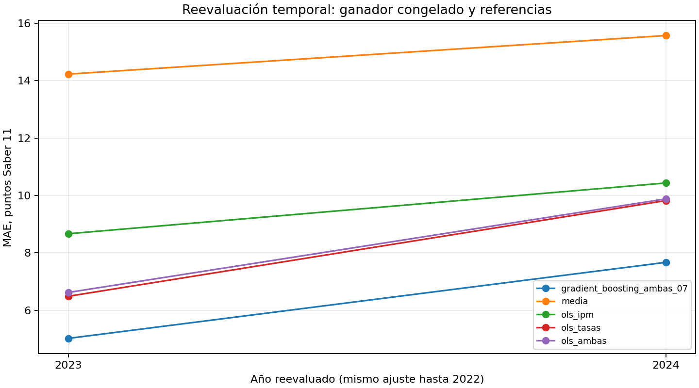

# Fase 3 — comparación reproducible y reevaluación temporal

2026-10-09, America/Bogota. Resultado **actual**, distinto de resultados históricos reportados y no reproducidos. Partida7e95ffe823c3d08f345620c0f9bc65dc72fae7d5; base198 SHA256609d73153ec7691567af5d460ffcf546cb54af1926662effd017a9ae05c50866. Se conservan media global, filtros, Bogotá,2021 y peso igual por territorio-año. La selección59 sigue archivada.

## Diseño ejecutado y trazabilidad

Protocolo v1.0 §§1–7, configuracion.py y candidatos_congelados.json determinan modelos, búsquedas, semillas, métricas y desempates. Las diferencias con PLAN líneas65–85 se documentaron antes de ajuste en decisiones.md. Sin ElasticNet, XGBoost o persistencia: no pertenecen a la búsqueda congelada. El desarrollo 132 tuvo ventanas expansivas33/66/99→33; sin2020 fabricado. OLS/Ridge escalan dentro de cada entrenamiento; no se usan otras transformaciones ni clipping. Predictores1/15/16, sin año/códigos/conteos/INSE/áreas/derivados de y. La estimación usa pobreza contemporánea, no anticipación ni causalidad.

Entorno aislado Python 3.12.14 y sklearn 1.9.1; defaults íntegros y versiones en resultados/preparacion.json, bloqueo en requirements.lock.txt. Se ejecutaron201 ajustes de ventana,7 finales y6 adicionales de verificación del ganador, incluidos tres del intento de cierre interrumpido por Unicode (sin reselección). Los67 candidatos completaron ventanas; fallos y advertencias de entrenamiento vacíos. Incidencias de infraestructura/verificación en incidencias_ejecucion.md se resolvieron sin alterar criterios.

## Comparación de todas las familias

La siguiente tabla presenta mínimos brutos por familia, no una selección nueva. Resultados exactos por67 candidatos: resultados/comparacion_desarrollo.csv. Métricas por201 ventanas y6.633 predicciones: metricas_ventanas.csv y predicciones_desarrollo.csv. El resumen de mínimos por familia/especificación está en resumen_familias_especificaciones.csv; media es común.

| familia | id | mae | rmse | sesgo | r2 |
| --- | --- | --- | --- | --- | --- |
| gradient_boosting | gradient_boosting_ambas_07 | 6.332499 | 7.764136 | 3.297261 | 0.779915 |
| random_forest | random_forest_ambas_05 | 6.504996 | 8.327778 | 3.996810 | 0.746801 |
| ridge | ridge_tasas_02 | 7.074271 | 8.779615 | 3.285771 | 0.718580 |
| ols | ols_tasas | 7.693311 | 9.492374 | 3.002022 | 0.671032 |
| media | media | 13.842431 | 16.991914 | 2.833713 | -0.054116 |

El ganador global gradient_boosting_ambas_07 también es mínimo bruto. Usa100 etapas, aprendizaje 0.1, profundidad 2, hoja mínima3, subsample 1, semilla 20261008 y16 entradas; parámetros completos en congelacion.json. GBR tasas queda a0.108025 puntos de MAE, fuera de tolerancia 0.1, por lo que no desplaza a ambas por parsimonia. No se interpreta esa diferencia pequeña como significación educativa ni contribución causal. Ridge y RF no superan al ganador. OLS tasas es la mejor referencia en desarrollo y no supera al mejor candidato de ninguna de esas tres familias. Comparaciones del resto de configuraciones permanecen en tabla completa: una referencia puede superar configuraciones menos favorables.

El sesgo del ganador en desarrollo es+3.297261 puntos. Estas son métricas usadas para selección; optimismo y dependencia impiden tratarlas como confirmación independiente.

## Reevaluación con mismos artefactos

Los7 objetos fueron ajustados con 132 filas y congelados a2026-10-09T15:20:08.821292+00:00 antes de errores reservados. El manifiesto congelacion.json fija ganador, parámetros, transformaciones y huellas; reevaluacion.json referencia su SHA256. Se aplicaron exactamente esos objetos a2023 y2024, sin actualización en 2023. No se reescogió ganador. Esta tabla reúne métricas sobre66 filas; las21 filas anuales/conjuntas completas, diferencias respecto de media y tres OLS están en metricas_reevaluacion.csv.

| id | n | mae | rmse | sesgo | r2 | delta_mae_media |
| --- | --- | --- | --- | --- | --- | --- |
| media | 66 | 14.903887 | 17.788017 | -5.290637 | -0.097048 | 0.000000 |
| ols_ipm | 66 | 9.552257 | 12.149070 | -0.868937 | 0.488251 | -5.351629 |
| gradient_boosting_ipm_02 | 66 | 9.768153 | 12.055652 | 0.078490 | 0.496091 | -5.135734 |
| ols_tasas | 66 | 8.155885 | 9.728699 | -5.194448 | 0.671844 | -6.748002 |
| gradient_boosting_tasas_07 | 66 | 6.436305 | 8.003991 | -2.922603 | 0.777882 | -8.467582 |
| ols_ambas | 66 | 8.252112 | 9.754632 | -5.486928 | 0.670092 | -6.651774 |
| gradient_boosting_ambas_07 | 66 | 6.345582 | 7.802886 | -2.779014 | 0.788903 | -8.558305 |

El ganador obtuvo MAE 5.020614 en 2023 y7.670549 en 2024; conjunto 6.345582, RMSE 7.802886, sesgo−2.779014, R² 0.788903. Se deteriora el MAE y aumenta subestimación en 2024; no se identifica causalmente el motivo. Ninguna referencia supera al ganador global en estos años, pero **OLS IPM supera a GBR IPM**: MAE conjunto 9.552257 frente a9.768153; también mejora en 2023 por0.128946 y en 2024 por0.302844 puntos. Es hallazgo relevante: la complejidad no aporta siempre. Alternativa verificable: comparar referencias explícitas con los mismos años/errores; decisión: conservar ganador de desarrollo e informar diferencia, sin búsqueda nueva. Comprobación: filas ols_ipm y gradient_boosting_ipm_02 de metricas_reevaluacion.csv, columna delta_mae_ols_ipm. No se evaluó cada uno de los67 candidatos en reserva: el protocolo autoriza únicamente ganadores y referencias congelados, evitando un segundo ranking.



La figura es descriptiva y muestra incremento anual del error; no ofrece intervalos i.i.d. ni prueba de superioridad. En462 predicciones (7×66) no hubo valores fuera de 0–500 y no se recortó ninguno. Cada fila de predicciones_reevaluacion.csv incluye código/nombre/año, observado, predicción y error. Valores exactos no se redondearon para selección.

## Verificaciones, límites y pendientes

resultados/verificacion.json certifica:67 candidatos completos,6633/462 predicciones, cobertura temporal/llaves, cálculo independiente de métricas, selección determinista,99 predicciones del ganador reproducidas en sus tres ventanas y462 predicciones reproducidas cargando artefactos. Comprueba152 archivos previos contra7e95ffe, salvo continuidad deliberadamente actualizada. El control de lectura CSV round_trip evita un falso fallo de hasta 5.7e-14; no altera resultados. Verificacion_notebooks.json registra fuentes/huellas, validación nbformat y ejecución real en kernel. Tras enriquecer narrativa se conservaron outputs de código idéntico, sin entrenar otra vez. Manifiesto_cierre.json permite comprobar huellas de entregables.

La reserva2023–2024 **no es prueba inédita**, por exposición documentada en prom.pdf pp.físicas13–14,18,22 y nueva ivestigacion .pdf pp.5–7, verificadas en fase1. Resultados históricos de clasificación no se transfieren a regresión. Persisten pocos años, dependencia territorial, diferencias de población Saber/IPM, procedencia local y fórmula global no autenticada. Las notas de comparabilidad IPM (auditoria/evidencia/notas_ipm.csv; protocolo §8) no se corrigen ni se usan para retirar2021. No hay inferencia individual ni causal.

No quedan controles indispensables activos para este procedimiento. Permanece pendiente, con nueva autorización de fase4, el contraste territorial predefinido y la revisión de robustez; sin ampliar búsqueda por estos resultados. Simulaciones y escenarios pertenecen a autorización posterior. Adopción editorial de la corrección de tesis sigue externa. Reproducción completa en una copia nueva está implementada pero no fue ejecutada como segunda búsqueda en esta sesión; se ejecutaron las verificaciones descritas. Continuidad contiene condición de avance y prompt siguiente.

## Resumen calculado por el procedimiento

```text
Mejor MAE bruto por familia (resumen descriptivo, no regla de selección):
          familia                         id       mae      rmse    sesgo        r2
gradient_boosting gradient_boosting_ambas_07  6.332499  7.764136 3.297261  0.779915
    random_forest     random_forest_ambas_05  6.504996  8.327778 3.996810  0.746801
            ridge             ridge_tasas_02  7.074271  8.779615 3.285771  0.718580
              ols                  ols_tasas  7.693311  9.492374 3.002022  0.671032
            media                      media 13.842431 16.991914 2.833713 -0.054116
Ganador congelado: gradient_boosting_ambas_07, 16 entradas; MAE 6.332499, RMSE 7.764136. Mínimo bruto 6.332499; diferencia 0.000000 puntos. La tolerancia y el orden fijados explican diferencias entre ranking bruto y selección.
Ganadores por especificación con referencia media común: {'ipm': 'gradient_boosting_ipm_02', 'tasas': 'gradient_boosting_tasas_07', 'ambas': 'gradient_boosting_ambas_07'}
Desarrollo: mejor ridge MAE=7.074271; referencias con MAE menor: ninguna. Comparación descriptiva tras búsqueda, no independencia estadística.
Desarrollo: mejor random_forest MAE=6.504996; referencias con MAE menor: ninguna. Comparación descriptiva tras búsqueda, no independencia estadística.
Desarrollo: mejor gradient_boosting MAE=6.332499; referencias con MAE menor: ninguna. Comparación descriptiva tras búsqueda, no independencia estadística.
Candidatos completos: 67 ; fallos registrados: 0 ; advertencias: 0
Ganador gradient_boosting_ambas_07, 2023: MAE 5.020614, RMSE 5.985372, sesgo -1.756802, R² 0.872020. ΔMAE frente a media -9.210814.
Referencias que superan al ganador en este conjunto: ninguna ; no se cambia la selección.
Ganador gradient_boosting_ambas_07, 2024: MAE 7.670549, RMSE 9.270673, sesgo -3.801227, R² 0.703958. ΔMAE frente a media -7.905796.
Referencias que superan al ganador en este conjunto: ninguna ; no se cambia la selección.
Ganador gradient_boosting_ambas_07, conjunto: MAE 6.345582, RMSE 7.802886, sesgo -2.779014, R² 0.788903. ΔMAE frente a media -8.558305.
Referencias que superan al ganador en este conjunto: ninguna ; no se cambia la selección.
Estas son reevaluaciones temporales actuales, no prueba inédita ni reproducción de métricas históricas. No hubo actualización con 2023, reselección ni interpretación causal.
```
