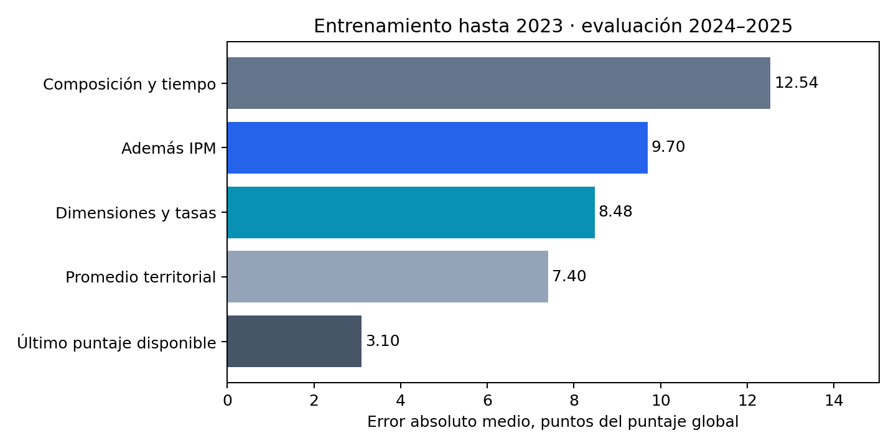
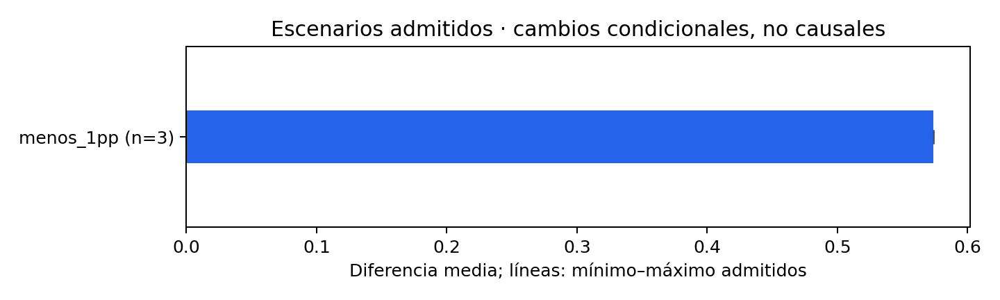

# Validación del modelo y estimación bajo escenarios

## Propósito y conexión con la investigación

El cuarto objetivo utiliza el modelo construido en el tercero para examinar dos preguntas: cuánto se aproxima a los puntajes departamentales observados y qué puntaje estima cuando se cambia el IPM manteniendo las demás entradas constantes. La primera pregunta evalúa capacidad predictiva. La segunda describe una comparación condicional; no permite afirmar cuánto aumentaría el desempeño si una política redujera la pobreza.

La ampliación acordada incorpora 2025 al periodo principal, por lo que se trabaja con 231 observaciones: 33 territorios en siete años, 2018, 2019 y 2021–2025. El año 2020 permanece excluido. La ubicación corresponde al departamento del colegio y la respuesta es la media global recibida, con los filtros auditados de estudiante, grado 11, ausencia de libertad marcada S y seis puntajes presentes y positivos. No se sustituye la respuesta por una fórmula reconstruida. La nueva preparación cotejó exactamente los conteos y las medias de las 231 observaciones; también verificó los niveles de Matemáticas sin discrepancias.

Fuente: preparacion/CONTROL_PREPARACION.json; preparacion/controles_raw.csv; fuentes/preparar.py. La población de objetivos anteriores no se amplía silenciosamente por este análisis.

## Un diseño focal para comparar aportes de la pobreza

Los modelos históricos del objetivo 3 resolvieron distintos problemas. El informe fase6 se concentró en 2018–2024; el contraste posterior V2 y la referencia de historia V6 utilizaron 2018–2025 y evaluaciones diferentes. Sus cifras no se mezclan como si fueran una sola prueba. La versión de historia sirve para comparar capacidad predictiva, pero no admite escenarios de IPM porque no utiliza pobreza como entrada.

Por esa razón se construyó un diseño adicional, delimitado antes de evaluar, que retoma las tres especificaciones de la metodología: composición y tiempo; las mismas entradas más IPM; y composición y tiempo más cinco contribuciones dimensionales oficiales y quince tasas de privación. Las proporciones de evaluados en establecimientos oficiales y en zona urbana y el número de evaluados se calcularon sobre la población elegible del mismo departamento y año. Las contribuciones representan porcentajes de aporte a la incidencia ajustada, no incidencias independientes de cada dimensión.

Para entender la regularización, puede imaginarse que el modelo busca una relación que se acerque a los datos sin dar un peso excesivo a cada entrada. Ridge reduce los coeficientes; Lasso puede dejar algunos en cero; ElasticNet combina ambos mecanismos. Se compararon quince configuraciones por especificación, después de poner las entradas en una escala común calculada únicamente con el entrenamiento. El criterio principal fue el error absoluto medio; ante diferencias pequeñas, se recurrió al error cuadrático y al orden de familias previamente fijado. Los años de evaluación no participaron en esa elección.

El modelo base primario eligió ElasticNet con alpha 1 y mezcla 0,8; el de IPM eligió Lasso con alpha 1; el de componentes eligió ElasticNet con alpha 1 y mezcla 0,2. Estos valores regulan cuánto se restringen los coeficientes; no son metas de mejora. El inventario completo conserva las configuraciones y sus errores internos.

La metodología original menciona efectos de año. Para estimar años posteriores se adoptó una tendencia numérica del tiempo y un indicador de 2021: un año categórico que nunca apareció en el entrenamiento no tendría un coeficiente aprendido. Esta adaptación se dejó escrita antes de evaluar y debe reflejarse en la versión final de la metodología; no se presenta como cumplimiento literal de efectos libres por año.

Fuente: ACA2, p.58; PLAN_Y_PROTOCOLO.md; resultados/CONGELACION_PREVIA.json; resultados/DECISIONES.json; resultados/seleccion_desarrollo.csv. Este es un diseño nuevo, no una reproducción del modelo fase6 ni del modelo histórico V6.

## Evaluación temporal y referencias

### Entrenamiento hasta 2023 y evaluación en 2024–2025

El corte principal adicional reúne 165 observaciones para entrenamiento y 66 para evaluación. Una vez escogidos sus parámetros mediante ventanas temporales internas, cada modelo se mantiene fijo para los dos años de evaluación. El error absoluto medio indica cuántos puntos se aleja, en promedio, la predicción del puntaje observado. El error cuadrático penaliza más los desvíos grandes; R² describe cuánto varía el error frente a una referencia basada en la media de los valores evaluados y no basta, por sí solo, para escoger un modelo.

| Especificación o referencia | MAE | RMSE | R² |
| --- | --- | --- | --- |
| Composición y tiempo | 12.538 | 14.729 | 0.283 |
| Además IPM | 9.704 | 12.031 | 0.521 |
| Dimensiones e indicadores | 8.479 | 10.251 | 0.653 |
| Promedio territorial | 7.405 | 8.076 | 0.784 |
| Último puntaje disponible | 3.103 | 4.114 | 0.944 |

Fuente: resultados/metricas.csv, corte2023, temporal, prom_punt_global, conjunto. Cada territorio-año tiene el mismo peso.

Figura. Error absoluto medio de las especificaciones y referencias. Fuente: resultados/predicciones.csv y fuentes/graficas.py; los valores se contrastaron con el cálculo independiente de métricas.

Incorporar el IPM reduce el MAE de 12,538 a 9,704 puntos frente al modelo base. Las dimensiones y los indicadores lo reducen a 8,479. Sin embargo, el promedio territorial obtiene 7,405 y el último puntaje disponible 3,103. Por tanto, este diseño ayuda a estudiar el aporte predictivo relativo de pobreza, pero no constituye la mejor herramienta para anticipar puntajes frente a referencias históricas sencillas.

La persistencia utiliza el puntaje observado del año anterior disponible; para 2025 incorpora 2024, mientras el modelo está congelado desde 2023. Esta diferencia informativa se hace explícita. Además, las entradas del año evaluado incluyen pobreza y composición observadas de ese año. La evaluación es retrospectiva y condicional; no acredita disponibilidad de esos datos antes del examen.

Los años 2023–2025 ya habían sido utilizados en trabajos previos. La separación actual evita emplearlos para seleccionar parámetros de esta ejecución, pero no los convierte en una reserva inédita. En consecuencia, no se conserva la afirmación original de que estos resultados provienen de una única evaluación sobre años nunca vistos.

Fuente: ACA2, p.59; resultados/DECISIONES.json; resultados/predicciones.csv. La diferencia MAE del modelo IPM menos base es −2,834 puntos; el remuestreo territorial de errores fijos arroja un intervalo descriptivo de −4,513 a −1,088. Este intervalo es condicional a modelos y años ya observados: no es una prueba confirmatoria de H3, no recoge toda la incertidumbre del proceso y no identifica efectos causales. Procedimiento: fuentes/modelos.py, bootstrap; resultados/DISPERSION.json.

### Corte previsto originalmente y comprobaciones de robustez

Se conservó por separado el entrenamiento hasta 2022, con 132 observaciones, y la evaluación 2023–2024, con 66. Así se evita sustituir el corte escrito por el que produzca una cifra más favorable.

| Especificación o referencia | MAE | RMSE | R² |
| --- | --- | --- | --- |
| Composición y tiempo | 11.935 | 14.458 | 0.275 |
| Dimensiones e indicadores | 7.880 | 9.624 | 0.679 |
| Además IPM | 9.807 | 12.028 | 0.498 |
| Último puntaje disponible | 3.584 | 4.489 | 0.930 |
| Promedio territorial | 5.599 | 6.250 | 0.865 |

Fuente: resultados/metricas.csv, corte2022, temporal, prom_punt_global, conjunto. Estas cifras no son comparables directamente con la tabla anterior porque cambian entrenamiento y años evaluados.

También se aplicó selección dejando un año fuera dentro del entrenamiento, como sensibilidad a la metodología escrita. En el corte principal, los MAE globales fueron 12,455 para base, 9,704 para IPM y 7,582 para componentes. Ese procedimiento puede utilizar años posteriores al año interno retirado; por ello se presenta aparte de las ventanas temporales y no se escoge retrospectivamente por su mejor resultado.

Para valorar transferencia territorial, cada departamento se excluyó completamente de la selección y del ajuste, repitiendo la selección interna con los otros 32. Los MAE resultantes fueron 10,987, 9,300 y 7,153 puntos para base, IPM y componentes. Este diagnóstico usa años de desarrollo coetáneos, no años futuros, y conserva los residuos departamentales sin retirar territorios de peor desempeño.

La robustez con la proporción de Matemáticas en niveles 3–4 mantiene las entradas y las ventanas, pero mide error en puntos porcentuales:

| Especificación o referencia | MAE, puntos porcentuales | RMSE, puntos porcentuales |
| --- | --- | --- |
| Composición y tiempo | 9.576 | 11.396 |
| Dimensiones e indicadores | 6.024 | 7.240 |
| Además IPM | 8.720 | 10.342 |
| Último puntaje disponible | 2.559 | 3.340 |
| Promedio territorial | 5.277 | 5.903 |

Fuente: resultados/metricas.csv, corte2023, temporal, mat34, conjunto; niveles contrastados con puntajes en fuentes/preparar.py. Ninguna predicción de esta comprobación quedó fuera de 0–100; no se recortaron predicciones para obtener este resultado.

Al excluir 2021 del desarrollo, el MAE global fue 12,323 para base, 10,804 para IPM y 8,130 para componentes, conservando la evaluación 2024–2025. Las comprobaciones muestran diferencias de magnitud entre diseños, pero no alteran la conclusión de que la referencia de persistencia obtuvo menor error en estas evaluaciones.

Fuente: resultados/metricas.csv, sin2021; resultados/DECISIONES_TERRITORIALES.json; resultados/residuos_departamentales.csv. Los parámetros y exclusiones territoriales pueden verificarse sin reproducir los ajustes.

## Construcción y límites de los escenarios

### Modelo y cambios considerados

Se utilizó el modelo auxiliar con IPM agregado, seleccionado con entrenamiento hasta 2023, sin elegirlo por sus resultados de evaluación. La referencia contiene las entradas observadas de 2025. Se propusieron reducciones de uno, tres y cinco puntos porcentuales de IPM y la convergencia de los territorios con mayor IPM hacia la mediana no ponderada de los 33 territorios, que fue 13,0. Esta mediana departamental no equivale a la incidencia nacional del DANE.

En cada comparación se mantuvieron el año, la composición escolar y el número de evaluados. No se interpreta como una proyección para 2026 ni se suma el cambio estimado al puntaje observado. Se comparan dos predicciones del mismo modelo. Su coeficiente de IPM fue -0.573608 puntos globales por punto porcentual de IPM: por tratarse de un modelo lineal común, una reducción de un punto produce la misma diferencia calculada en los territorios admitidos. No representa un efecto particular identificado para cada departamento.

Fuente: resultados/coeficientes_modelo_escenarios.csv; resultados/modelos/corte2023_prom_punt_global_temporal_ipm.joblib; fuentes/modelos.py, scenarios. Los escenarios corresponden a la especificación del índice agregado; no se cambian simultáneamente quince tasas marginales para fabricar un IPM coherente.

### Soporte y plausibilidad

Antes de calcular los resultados se exigió que el IPM propuesto fuera válido, estuviera en el rango de entrenamiento y en el rango histórico del mismo territorio. También se controlaron los rangos de composición y tamaño y la cercanía conjunta a observaciones de entrenamiento. Tanto la referencia como el escenario debían superar estas comprobaciones. El año 2025 extrapola la tendencia aprendida hasta 2023: los controles se refieren a las demás entradas y no certifican soporte temporal.

Las reducciones se contextualizaron con variaciones observadas. En las 165 diferencias de un año disponibles, 60,6 % muestran descensos de al menos un punto, 35,8 % de al menos tres y 17,0 % de al menos cinco. Las diferencias 2019–2021 se registraron aparte porque abarcan dos años. Estos antecedentes no garantizan que cada reducción sea realizable ni que una política determinada la produzca.

Fuente: PLAN_Y_PROTOCOLO.md, soporte fijado antes de ajustes; resultados/SOPORTE.json; resultados/variaciones_ipm_observadas.csv; resultados/DIAGNOSTICOS.json. La incertidumbre muestral del IPM y de sus tasas no se ha propagado a las predicciones; los escenarios deben leerse con esa limitación adicional.

### Escenarios que superaron los controles

Solo tres combinaciones con reducción efectiva superaron los controles: disminución de un punto de IPM en Meta, Sucre y Tolima.

| Departamento | IPM de referencia | IPM propuesto | Puntaje estimado de referencia | Puntaje estimado del escenario | Diferencia |
| --- | --- | --- | --- | --- | --- |
| Meta | 12.300 | 11.300 | 255.338 | 255.912 | 0.574 |
| Sucre | 25.400 | 24.400 | 243.957 | 244.530 | 0.574 |
| Tolima | 12.200 | 11.200 | 254.176 | 254.749 | 0.574 |

Fuente: resultados/escenarios.csv, admitido=True y reduccion_pp>0. Diferencias de predicciones, no efectos de política.

Figura. Diferencia media de las predicciones admitidas y rango entre territorios. Fuente: resultados/escenarios.csv y fuentes/graficas.py. Las entradas sin reducción efectiva no se cuentan como resultados de convergencia.

De 165 combinaciones examinadas, 13 superaron los controles: seis referencias sin cambio, cuatro entradas de convergencia que ya estaban por debajo de la mediana y no cambiaban el IPM, y los tres escenarios efectivos anteriores. Las otras 152 quedaron rechazadas. Ninguna reducción de tres o cinco puntos fue admitida; tampoco hubo convergencia efectiva admitida. El principal límite fue el rango histórico departamental: numerosos valores de 2025 ya estaban fuera de los rangos de entrenamiento. Las predicciones de los escenarios rechazados no se publican y sus motivos se conservan.

Este resultado acota el alcance del cuarto objetivo. Permite mostrar tres comparaciones condicionales locales y explicar por qué no es defendible presentar una simulación general para todos los departamentos. Ampliar el soporte después de observar los resultados ocultaría esa limitación. La alternativa académica es conservar el análisis de validación y los escenarios admitidos, y declarar expresamente la brecha para las reducciones mayores y la convergencia.

La reducción proporcional de tasas prevista en p.59 también requiere reformulación. Con tasas marginales departamentales no se determina la distribución conjunta de privaciones ni un IPM consistente; escalar todas las tasas no demuestra esa coherencia. Por ello se documenta la brecha y se propone limitar esta entrega a escenarios del índice agregado, sin afirmar que se ejecutó la simulación dimensional prometida.

## Alcance de las conclusiones

La pobreza aporta información frente a la especificación de composición y tiempo de este diseño, pero la historia reciente del puntaje constituye una referencia predictiva más fuerte. Los escenarios ilustran asociaciones del modelo auxiliar dentro de controles explícitos; no respaldan una promesa de aumento académico por reducción del IPM ni confirman causalmente H3.

Para integrar estos resultados, la metodología debe reconocer el periodo 2018–2025 acordado, la evaluación retrospectiva con años ya vistos, la adaptación temporal y la definición de mediana departamental. También debe declarar que la simulación de dimensiones e indicadores no fue ejecutada por falta de coherencia verificable con estas entradas. Estas decisiones permiten una exposición defendible sin presentar como cumplidos requisitos que permanecen abiertos. La tesis completa no se declara cerrada con esta fase.
